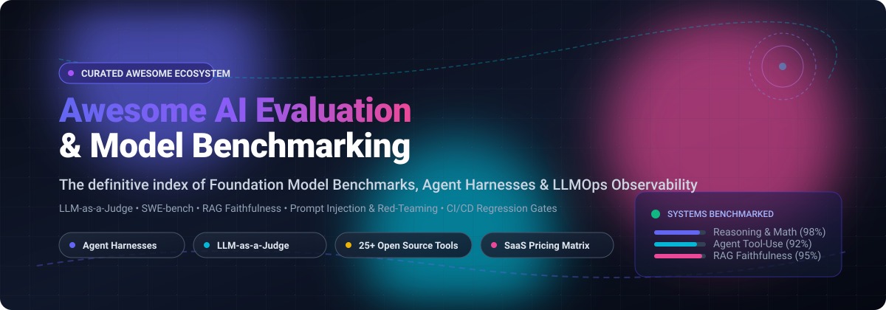

# 🌟 Awesome-AI-Evaluation-Model-Benchmarking

 
 

<!-- Badges Header -->

 
 

**The Definitive Curated Guide to Foundation Model Benchmarking, Autonomous Agent Evaluation Harnesses, RAG Faithfulness, LLM-as-a-Judge Suites, and CI/CD LLM Regression Testing** 🚀

Last updated: November 2026 • Curated with ❤️ by <a href="https://github.com/ishandutta2007">@ishandutta2007</a>

---

## 📖 Overview & SEO Summary 🔍

Welcome to the **Awesome AI Evaluation & Model Benchmarking** ecosystem repository! As Large Language Models (LLMs), multimodal foundation models, and autonomous agent workflows progress into enterprise production, systematic **AI evaluation**, **model benchmarking**, and **continuous quality observability** have transitioned from academic curiosities to critical infrastructure requirements.

Whether you are evaluating frontier models (OpenAI GPT-4o / o1 / o3, Anthropic Claude 3.5 Sonnet / 3.7 Opus, Google Gemini 2.0 / 2.5 Flash, DeepSeek V3 / R1, Meta LLaMA 3.3) or fine-tuned domain-specific architectures, this repository aggregates:

- 📊 **Foundation Model Academic Benchmarks**: Standardized multi-task reasoning, MMLU-Pro, GSM8K, GPQA, ARC, and HumanEval suites.
- 🤖 **Autonomous AI Agent Evaluation**: Rigorous sandboxed execution environments, multi-turn tool-use validation, SWE-bench software engineering tasks, and Web/OS trajectories.
- 🎯 **RAG & LLM-as-a-Judge Evaluation**: Groundedness, retrieval precision, context recall, faithfulness scoring, and synthetic golden-dataset generators.
- 🛡️ **AI Safety, Red-Teaming & Security**: Automated prompt-injection testing, toxicity scanners, hallucination detectors, and compliance benchmarks.
- 📈 **CI/CD Quality Gates & Telemetry**: Pytest-style assertions, regression testing harnesses, and OpenTelemetry-native trace waterfalls.

---

## 📑 Table of Contents

- [🌐 Sector Overview & Market Dynamics](#-sector-overview--market-dynamics)
- [🏢 SaaS & Hosted Evaluation Platforms](#-saas--hosted-evaluation-platforms)
- [💻 Open-Source GitHub Projects (Star-Ranked)](#-open-source-github-projects-star-ranked)
- [📈 Star History](#-star-history)
- [💖 Support & Sponsorship](#-support--sponsorship)
- [🤝 How to Contribute](#-how-to-contribute)
- [📜 License & Disclaimer](#-license--disclaimer)

---

## 🌐 Sector Overview & Market Dynamics

The global AI evaluation and LLM observability market is estimated at approximately **$1.4B–$2.0B** in 2026, projected to scale rapidly to over **$7.2B–$9.3B** by 2030 at a compound annual growth rate (CAGR) exceeding 33%. 

The sector is currently **moderately fragmented**: specialized startups and open-source communities drive aggressive algorithmic innovation across evaluation metrics (LLM judges, trajectory validators, synthetic test datasets, and hallucination detectors), while enterprise budgets and telemetry aggregation pipelines are progressively concentrating around full-stack observability incumbents and high-scale category leaders.

---

## 🏢 SaaS & Hosted Evaluation Platforms

| Platform | Description | Size (Valuation / Funding / Status) 📊 | Starting Tier Pricing 🏷️ | Free Tier / Trial Limits 🎁 |
| :--- | :--- | :--- | :--- | :--- |
| **[LangSmith (LangChain)](https://langchain.com)** | All-in-one cloud evaluation, dataset management, and observability platform enabling teams to run offline model benchmarks and online evaluators on agent trajectories. | **$3.0B** valuation ($460M total funding raised) | **$39 / seat / month** (Plus Plan; includes 10,000 base traces/month; extra traces at $2.50/1k) | **Free Forever (Developer Tier)**: 1 seat, up to 5,000 base traces/month, 14-day data retention. |
| **[Arize AX / Arize Phoenix Cloud](https://arize.com)** | Enterprise AI observability and evaluation platform delivering OpenTelemetry span tracing, drift detection, and automated LLM evaluation pipelines. | **$915M** acquisition valuation by Dynatrace ($131M prior funding; ~$15M–$45M ARR) | **$50 / month** (AX Pro Plan; includes 50,000 spans/month and 10 GB ingestion; overages at $0.0008/span and $3/GB) | **Free Forever (AX Cloud Free Tier)**: Unlimited users, 25,000 trace spans/month, 1 GB ingestion/month, 15-day data retention. |
| **[Braintrust](https://braintrust.dev)** | Enterprise AI evaluation, prompt playground, and logging platform designed to benchmark model and prompt upgrades side by side and prevent regressions across releases. | **$800M** valuation ($121M total funding raised) | **$249 / month** (Pro Tier; includes unlimited seats, 5 GB data, 50k scores, $100 model credits, 30-day retention) | **Free Forever (Starter Plan)**: Unlimited seats, 1 GB data/month, 10,000 scores/month, $10/month model credits, 14-day retention. |
| **[Patronus AI](https://patronus.ai)** | Automated AI evaluation and safety platform offering adversarial test generation, specialized hallucination detection models (Lynx), and enterprise compliance benchmarking. | **~$406M–$410M** valuation ($70M total funding raised) | **~$10 per 1,000 evaluator calls** (Self-serve API usage; Enterprise custom contracts) | **Free Forever (Developer Plan)**: 2 projects, up to 5 experiments per project, 14-day data retention, plus $10 free API trial credits. |
| **[Galileo](https://rungalileo.io)** | Enterprise AI evaluation and observability suite featuring proprietary hallucination guardrails, agentic trajectory metrics, RAG attribution scoring, and automated error clustering. | **~$100M–$250M** valuation ($68.1M total funding raised; acquired into Cisco/Splunk) | **$100 / month** (Pro Tier billed annually, or $150/month billed monthly; includes 50,000 traces/month) | **Free Forever (Developer Tier)**: Unlimited users/evaluations, up to 5,000 traces/month. |
| **[Vellum](https://vellum.ai)** | Cloud AI product development platform featuring quantitative multi-model evaluation matrices, prompt sandboxes, and versioned workflow deployments. | **~$80M–$250M** valuation bracket ($25.5M total funding raised) | **$30 / month** (Mighty entry tier; enterprise LLMOps evaluation contracts custom quoted) | **Free Forever (Base Tier)**: 1 vCPU / 2 GiB RAM instance, 6 GiB persistent workspace storage, managed LLM credentials. |
| **[Humanloop](https://humanloop.com)** | Enterprise LLM evaluation and prompt management workspace combining human-in-the-loop annotation workflows, custom model graders, and versioned benchmark datasets. | Acquired by **Anthropic** ($7.91M prior seed funding raised) | Acquired / Sunset for new billing (historically custom Enterprise contracts) | **Historical Free Tier Limits**: 2 team members, 50 evaluation runs, and up to 10,000 logs/month (acqui-hired by Anthropic). |
| **[HoneyHive](https://honeyhive.ai)** | AI observability and evaluation platform built for compounding agent reliability through production trace curation, human feedback loops, and CI/CD regression gates. | **$7.4M** total funding raised (Seed-stage) | Custom enterprise quotes / Startup tier for teams with <$5M funding | **Free Forever (Developer Plan)**: Up to 5 team members, 1 workspace, 10,000 events/month, 30-day data retention. |
| **[Confident AI (DeepEval Cloud)](https://confident-ai.com)** | Managed cloud evaluation platform built around DeepEval offering collaborative dataset curation, hosted LLM-as-a-judge metrics, red-teaming, and automated CI/CD regression reports. | **$2.7M** total funding raised (Seed-stage via Y Combinator & Flex Capital) | **$200 / month** (Starter Plan; includes unlimited user seats; additional trace storage at $1/GB-month) | **Free Forever (Community Cloud Plan)**: 2 user seats, 1 project, 5 test runs per week, 1 GB-month trace storage (7-day retention). |
| **[Vals AI / Artificial Analysis](https://artificialanalysis.ai)** | Independent cloud benchmarking and model evaluation platforms tracking speed, latency, token pricing, and domain-specific accuracy across frontier and open models. | **$2.6M** total funding raised (Seed-stage via Nat Friedman & Daniel Gross / AI Grant) | **$417 / month** (Pro Tier billed annually at $5,000/yr, or $499/mo; custom enterprise data licenses) | **Free Forever (Data API / Public Index)**: Free access to composite intelligence benchmarks, median speed/latency metrics, capped at 1,000 requests/day. |

---

## 💻 Open-Source GitHub Projects (Star-Ranked)

Curated list of the top open-source AI evaluation harnesses, benchmarking suites, and self-hosted tracing stacks, strictly sorted in **descending order by GitHub star count**. Each repository badge links directly to its stargazer community.

1. **[FastChat / Chatbot Arena (`lm-sys/FastChat`)](https://github.com/lm-sys/FastChat)**   
   An open platform for training, serving, and evaluating LLM-based chatbots, powering the world-renowned LMSYS Chatbot Arena human preference Elo-rating system.

2. **[Langfuse (`langfuse/langfuse`)](https://github.com/langfuse/langfuse)**   
   Open-source LLM engineering platform offering dataset experiment runs, LLM-as-a-judge evaluators, prompt management, user feedback scoring, and trace-level evaluation analytics.

3. **[Promptfoo (`promptfoo/promptfoo`)](https://github.com/promptfoo/promptfoo)**   
   Lightweight, blazingly fast CLI and library for declarative LLM benchmarking, side-by-side prompt engineering comparison, CI/CD regression testing, and automated security red-teaming.

4. **[Opik (`comet-ml/opik`)](https://github.com/comet-ml/opik)**   
   Open-source, end-to-end LLM evaluation and observability platform from Comet built for logging agent trajectories, managing evaluation datasets, and running LLM-as-a-judge metrics.

5. **[OpenAI Evals (`openai/evals`)](https://github.com/openai/evals)**   
   OpenAI's foundational framework for evaluating LLMs and systems built with LLMs, featuring composable scoring primitives, challenge sets, and model-graded evaluation logic.

6. **[DeepEval (`confident-ai/deepeval`)](https://github.com/confident-ai/deepeval)**   
   The leading open-source (`Apache-2.0`) Pytest-style LLM evaluation framework with 40+ research-backed metrics for agent tool correctness, task completion, faithfulness, hallucination, and red-teaming.

7. **[Ragas (`vibrantlabsai/ragas`)](https://github.com/vibrantlabsai/ragas)**   
   Supercharged evaluation and synthetic test-data generation toolkit specialized for Retrieval-Augmented Generation (RAG) measuring faithfulness, context precision, context recall, and answer relevancy.

8. **[LM Evaluation Harness (`EleutherAI/lm-evaluation-harness`)](https://github.com/EleutherAI/lm-evaluation-harness)**   
   The industry-standard model benchmarking framework from EleutherAI powering the Hugging Face Open LLM Leaderboard with 60+ standardized tasks (`MMLU`, `GSM8K`, `ARC`, `GPQA`, `HellaSwag`).

9. **[Arize Phoenix (`Arize-ai/phoenix`)](https://github.com/Arize-ai/phoenix)**   
   Open-source OpenTelemetry-native AI observability and evaluation suite featuring pre-built hallucination/relevance evaluators, span trace waterfalls, and benchmark experiment tracking.

10. **[Cleanlab Studio & Cleanlab Core (`cleanlab/cleanlab`)](https://github.com/cleanlab/cleanlab)**   
    The standard open-source library for data-centric AI and automated data quality evaluation, detecting mislabeled benchmark data, outlier tokens, and noisy evaluation sets.

11. **[Evidently AI (`evidentlyai/evidently`)](https://github.com/evidentlyai/evidently)**   
    Open-source machine learning and LLM evaluation platform evaluating model quality, semantic drift, text descriptor changes, and RAG pipelines in production and offline test suites.

12. **[OpenCompass (`open-compass/opencompass`)](https://github.com/open-compass/opencompass)**   
    Comprehensive LLM evaluation platform from Shanghai AI Lab supporting 100+ datasets across language, reasoning, math, coding, multimodal, and long-context capabilities.

13. **[SWE-bench (`SWE-bench/SWE-bench`)](https://github.com/SWE-bench/SWE-bench)**   
    Foundational software-engineering benchmark evaluating autonomous coding agents on their capability to resolve real-world GitHub issues end-to-end within isolated Docker containers.

14. **[Giskard (`Giskard-AI/giskard-oss`)](https://github.com/Giskard-AI/giskard-oss)**   
    Open-source QA, red-teaming, and regression testing framework for AI agents and LLM applications scanning for hallucinations, harmful content, prompt injections, and performance degradation.

15. **[lmms-eval (`EvolvingLMMs-Lab/lmms-eval`)](https://github.com/EvolvingLMMs-Lab/lmms-eval)**   
    The evaluation engine for Large Multimodal Models (LMMs), accelerating benchmarking of multimodal models across MMMU, MathVista, OCRBench, and video-reasoning challenges.

16. **[VLMEvalKit (`open-compass/VLMEvalKit`)](https://github.com/open-compass/VLMEvalKit)**   
    Comprehensive open-source evaluation toolkit for Vision-Language Models (VLMs) supporting standard multimodal benchmarks with zero-shot and few-shot evaluation pipelines.

17. **[AgentBench (`THUDM/AgentBench`)](https://github.com/THUDM/AgentBench)**   
    The first comprehensive benchmark evaluating Large Language Models as autonomous agents across diverse multi-turn environments including operating systems, databases, web browsing, and digital games.

18. **[EvalScope (`modelscope/evalscope`)](https://github.com/modelscope/evalscope)**   
    Streamlined model evaluation and stress-testing framework from ModelScope supporting standard academic benchmarks, Arena-style battle ranking, and inference throughput profiling.

19. **[TruLens (`truera/trulens`)](https://github.com/truera/trulens)**   
    Systematic evaluation and tracking library for LLM and RAG applications using programmable feedback functions to score groundedness, context relevance, and answer relevance.

20. **[Inspect AI (`UKGovernmentBEIS/inspect_ai`)](https://github.com/UKGovernmentBEIS/inspect_ai)**   
    Open-source evaluation framework developed by the UK AI Security Institute (AISI) for benchmarking complex reasoning, sandboxed agent tool-use, cybersecurity skills, and model safeguards.

21. **[HELM (`stanford-crfm/helm`)](https://github.com/stanford-crfm/helm)**   
    Holistic Evaluation of Language Models from Stanford CRFM benchmarking models multi-dimensionally across accuracy, calibration, robustness, fairness, bias, toxicity, and copyright efficiency.

22. **[PromptBench (`microsoftarchive/promptbench`)](https://github.com/microsoftarchive/promptbench)**   
    Microsoft Research's benchmark suite evaluating the adversarial robustness and prompt sensitivity of Large Language Models against character, word, sentence, and semantic perturbations.

23. **[LightEval (`huggingface/lighteval`)](https://github.com/huggingface/lighteval)**   
    Hugging Face's lightweight, flexible model evaluation suite supporting distributed inference backends (`vLLM`, `Transformers`, `Nanotron`, `TGI`) across hundreds of standardized tasks.

24. **[EvalPlus (`evalplus/evalplus`)](https://github.com/evalplus/evalplus)**   
    Rigorous code-synthesis evaluation framework extending HumanEval and MBPP with 80x more rigorous edge cases (HumanEval+ and MBPP+) to unmask fragile generated code.

25. **[Prometheus-Eval (`prometheus-eval/prometheus-eval`)](https://github.com/prometheus-eval/prometheus-eval)**   
    Open-source evaluators and fine-tuned open-weight judge models capable of assessing user-defined rubrics and custom criteria, matching GPT-4-as-a-judge quality at a fraction of the cost.

26. **[AutoEvals (`braintrustdata/autoevals`)](https://github.com/braintrustdata/autoevals)**   
    Open-source collection of out-of-the-box evaluation functions from Braintrust for scoring model responses, hallucination, translation quality, JSON validness, and Levenshtein distance.

27. **[LiveCodeBench (`LiveCodeBench/LiveCodeBench`)](https://github.com/LiveCodeBench/LiveCodeBench)**   
    Holistic and contamination-free code generation benchmark continuously harvesting problems from competitive programming contests across code synthesis, self-repair, and execution forecasting.

28. **[autonomous-ai/openharness](https://github.com/autonomous-ai/openharness)**   
    Open-source execution harness engineered for validating autonomous agents across sandboxed workflows, multi-step tool-use reliability, and reproducible task trajectories.

---

## 📈 Star History

---

## 💖 Support & Sponsorship

Thank you for visiting and using **Awesome-AI-Evaluation-Model-Benchmarking**! If you find this curated collection helpful for your research, team, or project:

- ⭐ **Star this repository** to help others discover the best AI evaluation tooling.
- 🍴 **Fork and share** it with fellow AI engineers, researchers, and MLOps teams.
- ☕ **Buy me a coffee / Sponsor**: If you'd like to support ongoing curation and development of AI benchmarking open-source resources, please visit the [GitHub Sponsor Dashboard](https://github.com/sponsors/ishandutta2007). Your support is deeply appreciated!

---

## 🤝 How to Contribute

Contributions are warmly welcomed! To suggest a new tool, benchmark harness, or platform:
1. Ensure the project is actively maintained and relevant to **AI Evaluation**, **Model Benchmarking**, **RAG Metrics**, or **LLMOps Quality Testing**.
2. If submitting a SaaS product, verify that exact tier pricing and specific free trial/plan limits are provided.
3. Open a pull request with factual descriptions and official links.

---

## 📜 License & Disclaimer

- Distributed under the [MIT License](LICENSE).
- Disclaimer: All product names, logos, and brands are property of their respective owners. Listing in this repository does not imply endorsement.
